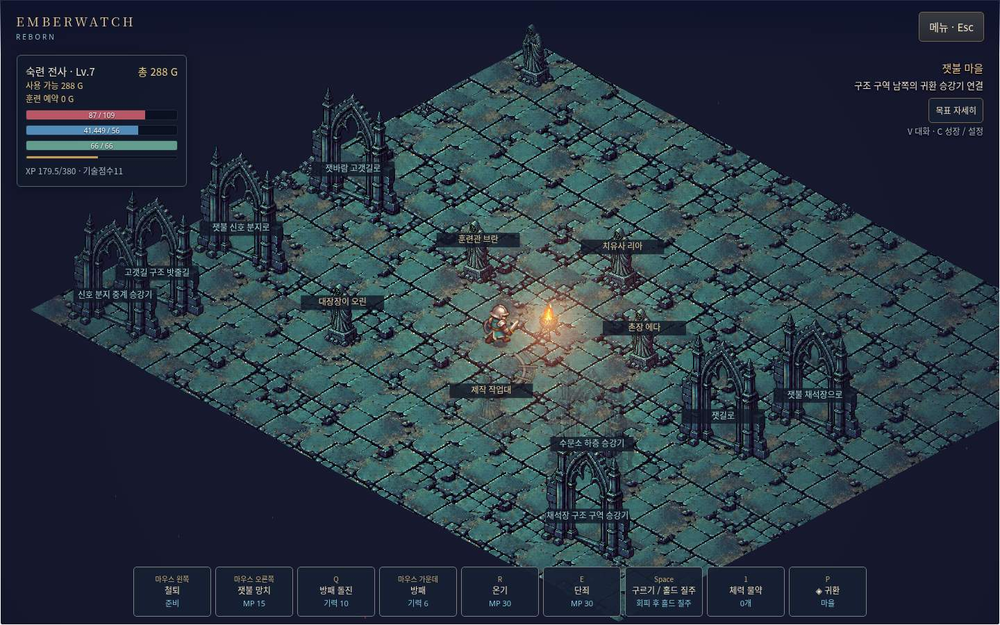
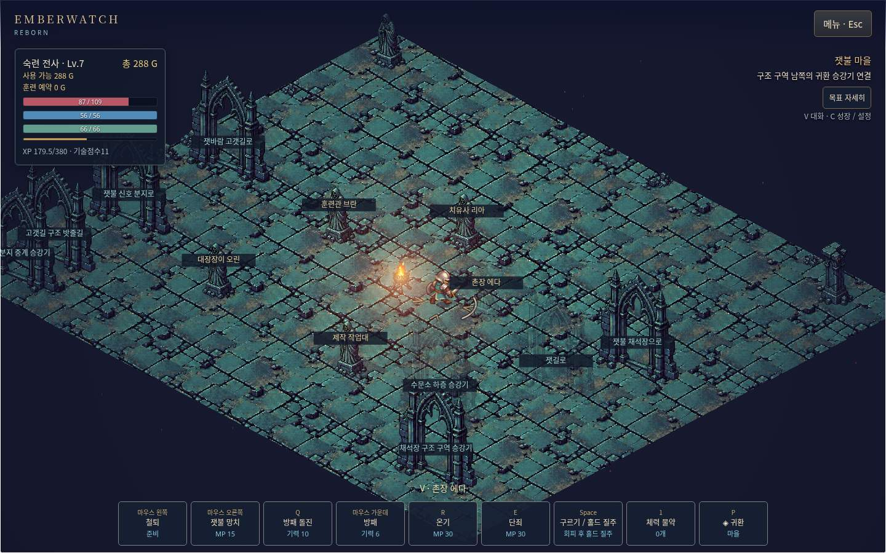

# 접촉 순간 pose와 바닥 모티프 원점

2026-10-14. 기준 `c127d905a27cb9e375e5fb9dc4f6bf6e53ed268f`. 읽기 전용 검토 후보를 실제 handler/frame 경로로 실행해 결함을 확인했다. 이 단위는 접촉 표현만 수정한다. 클릭 프리셋 터치 패드 후보는 다음 독립 단위다.

## 재현과 수정

`expert-main-input.test.mjs`의 생산 main key/frame/이벤트 전달/렌더 경로에서 철퇴를 실제로 시작한다. 적 없는 scripted earned fixture이며, 일반 플레이·실제 적 명중의 증거로 쓰지 않는다. 접촉 5ms 전까지 frame을 진행하고 W+D 측면 이동을 누른 뒤 지정 frame을 한 번 실행했다. 비교 대상은 실제 `slash` FX x/y/angle과 그 프레임 renderer에 전달한 `poeFeedback` snapshot이다.

| 한 frame | 수정 전 두 원점 거리(월드 단위) | 수정 후 |
|---|---:|---:|
| 1/30초 | 5.1 | 0 |
| 1/60초 | 2.1 | 0 |
| 1/120초 | 0.6 | 0 |

[red 로그](red.tap)에는 세 개 실패와 좌표를 보존했다. slash는 접촉 순간 `(260,325)`에서 발생했으나, 프레임의 남은 회수 보행 후 모티프가 플레이어의 새 위치에 만들어졌다. 프레임을 실행한 뒤 이벤트를 전달하는 순서는 바꾸지 않았다. PoE형 `actionContact`에 그 순간 복사한 `{pose:{x,y,angle}}`를 넣고 모티프가 그 pose를 사용한다. 늦게 읽는 플레이어 위치·동작 방향에 의존하지 않는다. 기존 pose 없는 이벤트 호출은 기존 player fallback을 유지한다. storm의 ordinal contact도 같은 runtime event 형태로 맞췄지만 기존 skip 규칙은 그대로다. 기존 모드 이벤트에는 pose를 추가하지 않는다. channelPulse 표현은 이번 변경 대상이 아니다.

판정·피해·접촉 시간·회수 보행·충돌·RNG·비용·쿨다운·오디오·저장 형식을 바꾸지 않았다. 보호 장비/저장 코드나 다른 namespace/hook을 사용하지 않았다.

## 실제 화면 검수

기존 정상 진행 프로필 `qa-judgement-persistent-20261014`를 그대로 사용했다. 브라우저는 Chromium151 headless/muted, 기존 로컬 서버4187과 표준 CDP9224다. 설정 UI에서 WASD 프리셋을 확인 버튼까지 선택하고 좌클릭 철퇴와 W+D 이동을 수행했다. 업데이트는 정상 저장 후 시작 화면→reload→Continue로 읽었다. 기존 모드 이벤트 계약을 유지하도록 좁힌 최종 build에서도 같은 정상 입력을 다시 캡처했다([최종 화면](images/final-side-mace-007.jpg)). 입력 관측에서 실제 시작/판정 기록을 확인했으며, 정상 프로필의 기술·장비·XP·골드는 유지됐다. 생산 Canvas를 원본 JPEG로 캡처하고 직접 열어 모티프·기존 아트·HUD 렌더를 검수했다. page error는0이었다.

두 화면은 서로 다른 마을 위치·시간·브라우저 프레임이다. 화면으로 소수점 원점 차이를 측정하거나 동기화된 A/B·고정 FPS·물리 지연으로 주장하지 않는다. 정확한 5ms 경계 비교는 위 생산 handler 검사다. [원본 수신 메타데이터](after-confirmed-side-mace-frames.json), [정상 입력과 정리된 읽기 전용 요약](native-observations.jsonl), [이미지 SHA256](screenshots.json)을 함께 남겼다. 이미지 4개는 신규 Git 증거의 명시적 승인 범위이며 편집/합성 없이 원본 바이트를 복사했다. 텍스트 로그는 줄 끝 공백만 정리했다. 원본 슬롯과 Chromium 프로필은 Git에 넣지 않았다.

실패도 보존했다. `pose-001`은 프리셋 확인 버튼을 누르기 전 menu selector를 찾아 timeout됐다. `pose-003` 첫 재로드 직후 철퇴는 저장된 기존 cooldown으로 거절돼 성공으로 세지 않았다. `pose-004`에서 자연히 회복을 기다린 뒤 실제 입력을 다시 수행했다. 첫 focused392개 실행은 수정 과정에서 storm 접촉의 `p` 변수 오류로391pass/1fail이었다. 이를 `b.p`로 수정하고 해당 실제 storm 경로와 세 원점 검사를 다시 실행해 [4/4](corrected-focused.tap) 통과했다. 첫 실패 로그도 [focused.tap](focused.tap)에 그대로 남겼다. 첫 전체 실행은4693개 중4690pass/3fail이었다. 추가 pose가 기존 이동/정지 공격의 전체 이벤트 동일성 검사를 깨뜨려, 일반 contact의 pose 추가를 PoE형 runtime에만 제한했다. 기존 비교 테스트를 완화하지 않았다. [첫 전체 실패](first-full-event-contract-fail.tap)와 [기존 회수 이동 재검사](legacy-recovery-green.tap)를 보존하고 최종 전체 검사를 다시 실행했다.

## 검증과 한계

최종 전체 검사는4693/4693 통과, 실패/skip/cancel0,495432.009646ms다. 전체 검사 수·시간·실패/skip/cancel은 [summary.json](summary.json)과 [새 full.tap](full.tap)에 있다. 기존 pass 수를 재사용하지 않는다. [앱 lint](lint.txt), [앱 build](build.txt)는 통과했으며 build는133파일/16,800,429바이트다. [공통 verify](common-verify.txt)·[registry](registry.txt)·[build:vercel](common-build.txt)는 Corepack `/home/agent/.cache/node/corepack/v1` ENOENT로 실패했다. 공통 브라우저 단계 통과가 아니다.

[보존 대조](preservation.json): 두 runtime 파일 외 소스/자산132개, 원본 Emberwatch167개, 다른 tracked1451개가 기준 blob과 일치한다. cb-ll 체크아웃은 깨끗하다. 일반 저장 UI는 사용했지만 serializer/writer 변경은 없다. a19 거절 해소 전 제한과 밸런스 보류를 유지한다.

실제 청음·물리 터치 하드웨어·키→화면/스피커 지연·사람의 체감·OS AX·장시간 성능은 미검증이다. 첫 파쇄 빌드 전체 완성이나 다른 빌드의 실전 완료 선언이 아니다. Library의 기존 Forbidden 전송도 재시도하거나 다른 전송으로 우회하지 않았다. Git 근거는 Library 백업 완료가 아니다. main 병합·배포는 하지 않는다.
