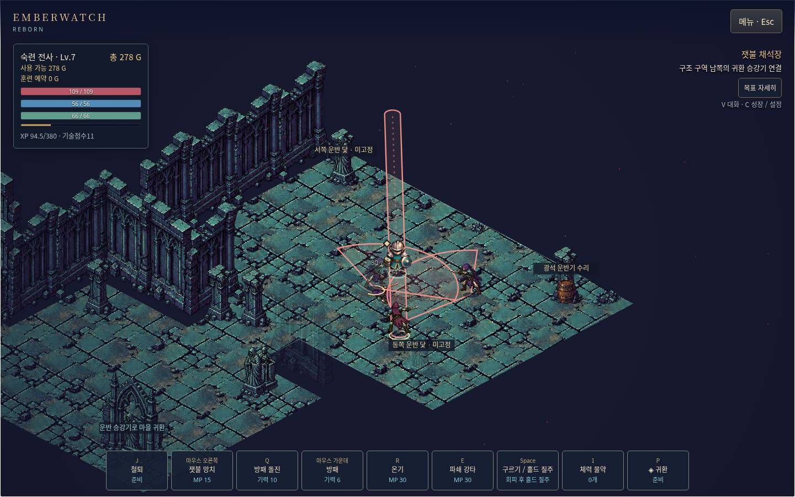
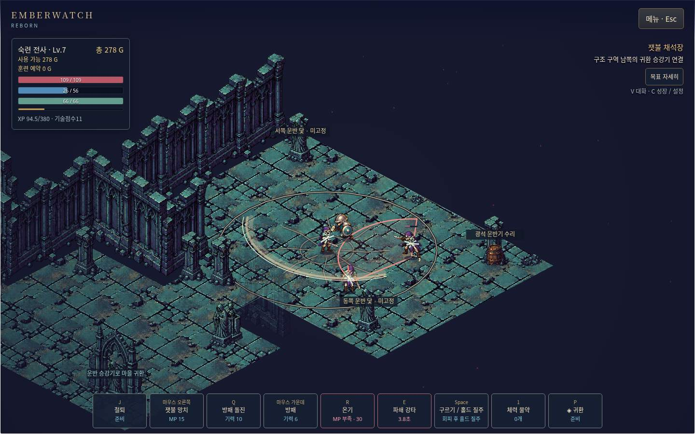
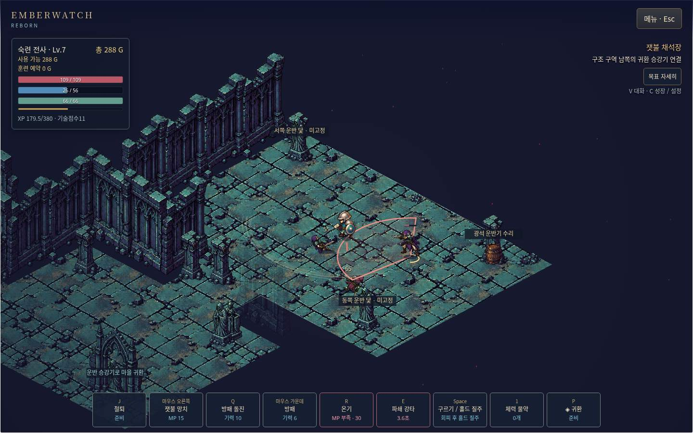

# 정상 해금 Judgement · 실제 파쇄 전투 검증

2026-10-14, 기준 `ba7b346d65bcacf5bc0351373d8b624acc41ed02`. `/workspace/emberwatch-reborn`의 별도 체크아웃, `codex/emberwatch-rebuild`에서 수행했다. main 병합·기본 배포는 하지 않았다. 이 체크포인트는 파쇄 한 빌드의 제한된 실제 전투 근거이며 PoE2급 완성, 전체 요구사항 완료 또는 다른 세 빌드의 실플레이 통과 선언이 아니다.

## 이번 변경

빈 마을에서 정상 학습한 단죄를 사용해도 입력 관측 패널이 `actionContact`를 “실제 접촉 이벤트 / 접촉”으로 표시했다. 이것은 적 명중이 아닌 공격 판정 구간의 시점이다. 패널 문구만 **타격 판정**으로 바꾸고, 허공 공격에도 기록되며 적 명중·피해·파쇄 발동을 증명하지 않는다고 명시했다. 이벤트 종류, 전투·입력 처리, 비용·쿨다운, 밸런스, 오디오, 저장·장비 코드는 바꾸지 않았다.

[수정 전 빈 마을 시험](images/p40-empty-earned-judgement-observation-before.jpg)과 [수정 후 정상 재로드 시험](images/p44-empty-earned-judgement-observation-after.jpg)은 서로 다른 실제 입력이다. 시각·누적 건수가 다른 이 두 장을 동기화된 성능 A/B로 해석하지 않는다.

## 환경과 증거 구분

지원 도구 목록에 전용 browser/computer/청음 도구가 없음을 직접 확인했다. 설치된 Chromium `151.0.7922.173`과 Python Playwright의 표준 로컬 CDP 연결로 **같은 기본 브라우저 컨텍스트**에 키·마우스·보이는 버튼 입력을 보냈다. 1440×900 headless, mute-audio 환경이다. CDP는 브라우저 조작/화면 캡처 경로이며 게임 내부 JSON hook, writer, 디버그 grant 또는 상태 import가 아니다.

빈 프로필 `qa-judgement-persistent-20261014`를 기존 `/qa-r14/`의 정상 새 게임으로 시작했다. 이후 이어하기는 기존 UI만 사용했다. 읽기는 DOM/localStorage getItem으로만 했다. 원본 슬롯 내용과 Chromium 프로필은 Git에서 제외하고, [정리된 요청·결과](native-observations.jsonl)에 입력·UI 문구·읽기 전용 필드 요약과 payload SHA256만 보존했다. 보상이 발생하는 행동은 기존 정상 구매·훈련·퀘스트·전투 UI로 실행했다.

앞선 임시 브라우저 프로필은 도구 세션 재연결을 잃어 보존만 했다. 그 기록을 가져오거나 주입하지 않았다. 이번 영속 브라우저도 도구 세션이 끊기면 표준 CDP로 같은 컨텍스트에 다시 연결했으며, 완료된 요청 번호를 재실행하지 않았다. 자동 조작 경로는 소스 지도와 현재 화면을 참고했으므로 처음 보는 사람의 길찾기·체감 조작 평가가 아니다.

## 정상 진행과 전투 결과

| 항목 | 실제 관측 / 요청 번호 | 판정 |
|---|---|---|
| 철퇴·방패·갑옷 | 기존 구매/장착 UI. iron_mace 32G, oak_shield 28G, guard_coat 34G. 기존 세 장비 ID 유지 | 이번 진행 확인 |
| 첫 던전 | 상층 crank/record, 경비·제어실 전투, water→gear→ember 봉인, inlet0/outlet1/flow2, 하층 승강기·봉인종·심장지기·핵 회수 | 정상 UI로 수행 |
| 봉인 중 저장·재로드 | 1/3에서 정상 저장 후 이어하기, 장비와 순서 유지 (`019`) | 확인 |
| 숙련·Judgement | 핵 보고로 위임장(`037`), 브란 무료 숙련 승급, 단죄1과 온기1 각각 2점 구매(`039`), 7→3점 | 정상 해금 확인 |
| 첫 실제 파쇄 | 철퇴 2회 실제 명중→준비 다이아몬드(`049`)→E(`050`). 충격파·균열·피해 숫자, 처치33→37 | 실제 명중/발동 확인 |
| 첫 장면의 적 예고 겹침 | `050`은 적 4명을 모두 처치해 예고가 사라짐 | 겹침 통과 근거로 쓰지 않음 |
| 구르기 취소 | `061`: E 시작 후 50ms 기다려 Space, E 판정 미관찰. 69프레임 캡처와 UI 기록, MP 비용·CD는 유지 | 시작 취소 확인; 청음 아님 |
| 사망과 차단 | `062` 정상 사망, 금화288→274(5% 버림14). `063` E/Q/P/J/Esc 후 payload 동일, reload/Continue 후 HP0 | 확인 |
| 부활·재진입 | `064` Enter로 정상 마을 부활, 기술·XP·퀘스트·처치 ledger·장비 ID 유지. 파쇄 선택을 다시 정상 UI로 지정, 채석장 재진입 | 확인 |
| 재진입 후 실제 겹침 | `069` 두 경비를 다른 방향으로 두고 한 경비 준비→`070` E. 실제 충격파/균열 아래에 바닥, 그 위에 살아 있는 경비의 붉은 쓸기 예고와 몸체. 이후 충격파만 만료 | 새 원본 화면 확인 |
| 허공·후딜·홀드 | `071`의 E는 recovery-too-early, 성공으로 세지 않음. `072`는 수락된 허공 E(판정 시점 있음), 처치/XP/금화 불변, 선택한 프레임에 지면 파쇄 없음. E 뒤 홀드 반복15, 구르기 뒤17/18 확인 | 수락/거절/재개 분리 확인 |
| 마지막 귀환·재로드 | `073` P/V 마을 귀환, 저장 후 시작 화면→reload→Continue. 기술·장비·XP·골드·목표·처치 유지 | 확인 |

수치·창·규칙은 기존 Emberwatch 자체 값이다. 위 기록으로 원작 PoE2의 수치나 동등 체감을 주장하지 않는다. 단죄의 허공 모션 호와 유효 파쇄의 지면 충격파는 구분한다. 근거 없는 “관측 contact=실명중” 계산을 사용하지 않았다.

### 실제 준비 → 충격파와 경비 예고 → 충격파 만료

이 세 장은 주입된 renderer fixture가 아닌 정상 캠페인 캐릭터의 실제 입력 장면이다. `p71` 프레임018/025는 같은 CDP 캡처 묶음이다. 프레임 메타데이터는 [원본 수신 목록](p71-live-warning-payoff-frames.json)에 있다. 수신 순서에 작은 timestamp 역전(007/008)도 그대로 보존했으며, 고정 FPS/물리 프레임 지연으로 환산하지 않는다. 캡처 부하도 포함된다. 앞 체크포인트의 controlled renderer 비교는 별도 문서에 남아 있고 여기서 일반 플레이로 재분류하지 않았다.

## 실패·관측 한계도 보존

초기 WASD를 클릭 이동 모드에 보낸 시도, 아직 반영되지 않은 저장 위치로 계산한 이동, 기술점수 부족으로 비활성인 철퇴 다음 랭크, 경비0/3일 때 봉인 실행, 사거리/방향이 맞지 않은 철퇴 허공, `027` 승강기 버튼 timeout, `043` NPC 문맥에 닿지 않은 시도, `071` 너무 이른 E 거절은 성공이 아니다. `039` 구매 직후 캡처는 제목이 잘려 있어 해금의 단독 화면 근거로 쓰지 않았다. 실제 해금은 정상 버튼 기록과 읽기 전용 스냅샷, 이후 E 사용을 함께 본다. 확인된 정상 후딜 거절을 입력 누락 버그로 고치지 않았다.

스크린샷 원본 11개는 새 비민감 JPG/PNG의 Git 문서 포함을 명시적으로 허용한 현재 위임 범위로만 추가했다(옛 AGENTS의 일괄 QA 이미지 제외보다 우선). 기존 Library Forbidden 파일이나 원본 자산을 다른 경로로 재전송한 것이 아니다. 총 1,221,865바이트. 이미지 원본 파일을 그대로 복사했고 편집/합성/재생성하지 않았다. 텍스트 검사 로그는 줄 끝 공백만 정리했다. [파일별 SHA256·설명](screenshots.json)을 참고한다. 사진을 제외한 원본 연속 캡처/브라우저 프로필은 로컬 제외 폴더에 있다.

## 자동 검증

| 검사 | 이번 결과 |
|---|---|
| 새 회귀검사 red | 정상 handler/frame의 허공 단죄가 actionContact를 내지만 enemyHit/파쇄는 내지 않음. 수정 전 문구 기대에서 의도대로 실패: [red](observation-red.tap) |
| 관련 입력 파일 | [231/231, 150001.005701ms](observation-focused.tap) |
| 최종 전체 앱 검사 | [4690/4690, 실패/skip/cancel 0, 499312.992710ms](full-final.tap). 이전 4689 수를 재사용하지 않음 |
| 앱 lint | [통과](lint-final.txt) |
| 앱 build | [통과](build-final.txt): 133파일, 16,800,289바이트, 0.14.0-reimplementation.18 |
| 읽기 전용 실제 저장 대조 | [10개 한정 대조](native-checks.json) true. 이것은 게임 전체 테스트 수가 아님 |
| registry / 공통 build / 공통 verify | 각각 [registry](registry-final.txt), [build:vercel](common-build-final.txt), [verify](repository-verify-final.txt)에서 Corepack `/home/agent/.cache/node/corepack/v1` ENOENT. 공통 build/공통 playtest 통과 아님 |

테스트 fixture는 생산 handler/frame을 실행하되 scripted earned fixture를 사용한다. 위 일반 브라우저 플레이나 청음의 대체물이 아니다. 새 회귀검사는 패널을 열어도 상태·revision이 변하지 않음을 확인한다. 기존 저장 지원 코드를 새로 만들거나 a19 거절 동작을 재현하지 않았다.

[보존 대조](preservation.json): `main.js`의 읽기 전용 문구 외 소스/자산133개, 원본 Emberwatch167개, 다른 tracked 파일1451개가 기준 Git blob과 일치했다. `/workspace/cb-ll` 상태는 깨끗했다.

## 남은 미완료와 차단

- mute/headless 환경이므로 **실제 소리·청음·타격 음질 미검증**. 소리 요청 “수락”은 재생 시작/스피커 출력 증거가 아니다.
- 물리 키→디스플레이/스피커 지연, 사람이 느끼는 입력·모션 품질, OS focus/AX, 터치·전체 접근성, 안정적인 장시간 FPS와 stall 해결은 미검증이다. 화면/동기 JS 관측만 확인했다.
- a19 거절 원문·검증된 해소 정보가 없다. 보호 장비/저장 모듈 변경, 별도 namespace/hook을 통한 우회는 하지 않았다. 한손/양손·좌우 반지/목걸이/벨트·Master13 실효과·반복 원정은 계속 미완료다.
- 기존 지역 재진입/남은 적 전투는 반복 원정 시스템 완성이 아니다. 파쇄 빌드의 실청음/물리 입력 등 남은 수용 기준 때문에 한 빌드 완결로 선언하거나 나머지 근접3빌드로 확장하지 않았다. 밸런스 미세 조정은 계속 보류다.
- 앞선 Library 정식 transfer는 Forbidden으로 완료되지 않았다. 이 작업에서는 재시도/대체 업로드/배포하지 않았다. Git·로컬 근거는 확보했으나 요구된 Library 백업 완료로 표현하지 않는다.

다음 작업은 청음/물리 조작 가능한 환경에서 같은 정상 프로필의 파쇄 수용 기준을 닫는 것과 부모의 검증된 a19 해소 정보 확인이다. 공통 빌드 환경 문제도 별도로 남는다.
