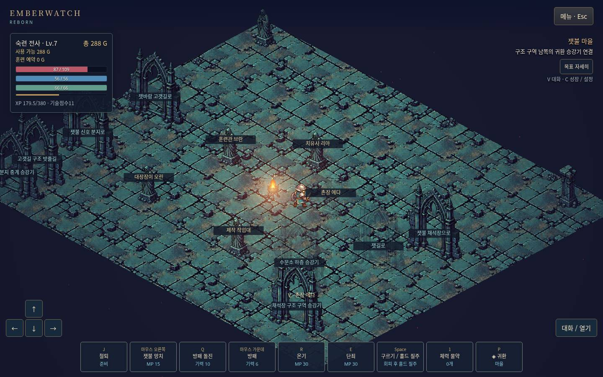
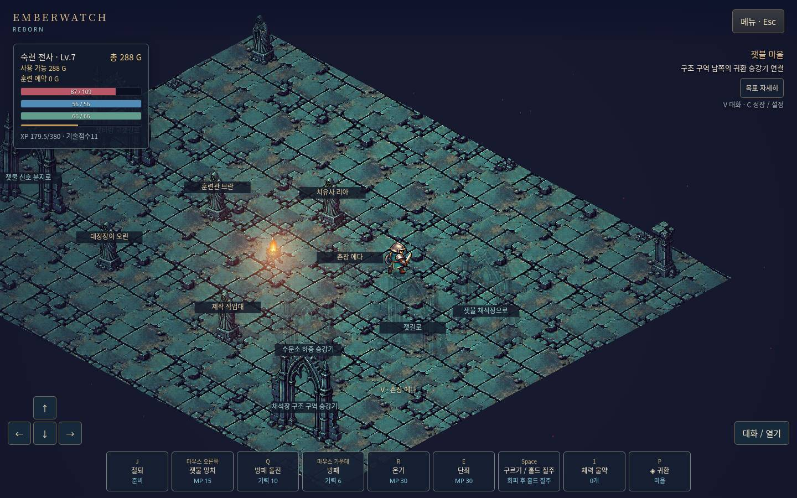
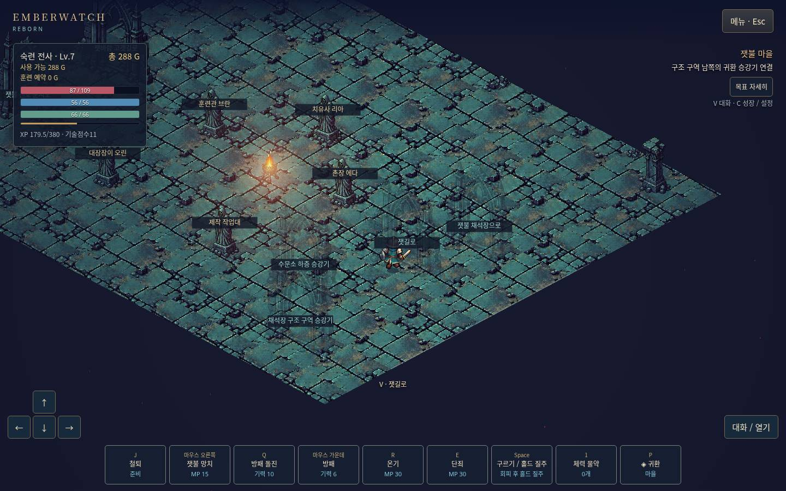

# 클릭 프리셋의 화면 방향 패드 연결

2026-10-14. 기준 `9334bd1806ba3279af62f46e966973c986a34104`(첫 접촉 pose 단위). 검토 후보를 생산 pointer handler와 브라우저 UI에서 재현한 뒤 수정했다. 기존 정상 진행 프로필을 계속 사용했으며 성장·장비·저장 형식 변경이 아니다.

## 확인된 결함과 변경

방향 패드의 pointerdown은 router의 `Touch:down` 등에 도착했지만, main이 이를 키보드와 합친 `keys`로만 보냈고 click locomotion은 그 값을 사용하지 않았다. 목적지가 없는 클릭 모드에서 패드가 움직이지 않았다. WASD 모드에서는 같은 패드가 이미 동작했다.

router가 누른 화면 방향을 임시 `touchMove`로 구분하고 main이 기존 화면→월드 변환을 적용해 locomotion에 전달한다. 클릭 모드의 이 방향은 이전 바닥 목적지를 대체한다. 패드 입력 시 이전 NPC 접근도 취소해 손을 뗀 뒤 오래된 목적지/대화가 재개되지 않게 한다. pointerup/cancel/capture-loss는 기존 가상 입력 해제로 멈춘다. Stop/제자리 공격 우선순위와 새 클릭 이동은 유지한다. WASD는 기존 키/패드 합성 경로를 사용한다. 클릭 모드 키보드 걷기는 계속 무시한다. 현재 조작 안내에도 화면 패드가 두 모드에서 동작하고 이전 클릭 목적지를 취소함을 설명했다.

`touchMove`는 접속 중 입력 snapshot일 뿐 저장 옵션/키맵이 아니다. 설정 schema·migration·bindings·skill slots·충돌·이동 속도·전투 수치·비용·밸런스·저장 코드는 바꾸지 않았다. 새 namespace, JSON save hook, 장비/성장 writer를 만들거나 a19 제한을 재현/우회하지 않았다.

## 실제 브라우저 UI 비교

Chromium151,1440×900 headless/muted와 기존 로컬 CDP9224/서버4187을 사용했다. `Emulation.setTouchEmulationEnabled`로 `(pointer:coarse)` 화면 패드를 표시하고, 보이는 패드 중앙에 표준 `Input.dispatchTouchEvent`를 보냈다. 실제 DOM에서 `isTrusted:true`, `pointerType:touch`인 pointerdown/up/lostpointercapture가 관측됐다. 화면/입력은 브라우저 경로이며 물리 손가락·OS 터치 하드웨어 검증이 아니다. 게임 모듈/상태에는 접근하지 않았다. 이벤트 관측은 DOM 이벤트 기록뿐이다.

기존 프로필 `qa-judgement-persistent-20261014`에서 설정 프리셋과 확인 버튼을 정상 클릭했다. 각 시험 시작/끝 위치는 정상 메뉴 체크포인트 후 localStorage getItem으로 읽었다. 원본 슬롯을 쓰거나 가져오지 않았다. 설정 변경은 사용자가 보는 기존 UI만 사용했다. 각 모드 trial 안의 설정·기술·장비·XP·골드는 유지됐다.

| 브라우저 시험 | WASD 패드 이동 | 클릭 패드 이동 | 손을 뗀 뒤 추가 이동 |
|---|---:|---:|---:|
| 수정 전 | 182.988 | 0 | 두 모드0 |
| 수정 후 | 179.964 | 180.000 | 두 모드0 |

단위는 월드 좌표다. 800ms 홀드 중 원본 스크린샷을 찍는 시간도 들어 있으므로 속도/물리 지연 벤치마크가 아니다. 이후250ms와 별도450ms 구간에서 이동이 남지 않았음을 확인했다. 각 버전의 두 모드 합계 trusted touch 이벤트는6개이고 page error는0이었다. [수정 전](native-before.json)·[수정 후](native-after.json)에 좌표·설정과 관측 이벤트를 보존했다.

### 수정 전 클릭 패드: 누르기 전 / 누른 동안

### 수정 후 클릭 패드: 누르기 전 / 누른 동안

화면은 원본 프레임이며 플레이어를 따라 카메라가 이동한다. 버전 간 위치·시간이 다른 정상 시험이다. 조작 결과는 위치 대조와 이벤트 기록을 함께 본다. 그림만으로 물리 응답성이나 동기화된 A/B를 주장하지 않는다. [선택 이미지7개 SHA256](screenshots.json), [일반 재로드 입력과 읽기 전용 요약](native-observations.jsonl)을 함께 제공한다. 새 비민감 Git 증거의 명시적 승인 범위이며 편집/합성/재생성 없이 원본 JPG 바이트를 복사했다. 원본 save slots·Chromium 프로필·임시 소스 사본은 Git에 넣지 않았다.

## 입력·취소·재로드와 실패 구분

[추가 UI 시험](native-edges.json)에서 클릭 모드 W 키의 이동은0, 바닥 클릭 직후 패드가 이동을 대체했고 touchCancel 이후 추가 이동은0이었다. 설정·기술·장비·XP·골드·통계는 정상 reload/Continue 후 유지됐다.

이 시험의 마지막 새 클릭은 **채석장 포탈에 닿아 지역이 바뀌었다**. 처음 자동 대조가 좌표 거리만 보고 바닥 이동 성공으로 분류했지만 화면·지역 검토로 그 합격을 취소했다. 해당 `freshClickStillMoves`는false로 정정했고 원 시도/좌표/검토 사유를 보존했다. 포탈 이동의526.034를 바닥 보행 거리로 사용하지 않는다. 이어 [별도 바닥 클릭](native-floor.json)을 수행해 **같은 채석장 안에서101.988 이동**, 진행·설정 불변, page error0을 확인했다. [원본 화면](images/after-fresh-floor-click.jpg)도 검수했다. 이후 P/V로 정상 마을 귀환→저장 후 시작 화면→reload→Continue를 수행했다. 마지막 정상 프로필은 마을/Lv7/XP179.5/44처치/1사망/288G이며 기존 철퇴4·단죄1·온기1과 장비 세 ID를 유지한다.

## 자동 검사

기존 생산 main의 pointerdown/frame/pointerup을 실행하도록 DOM pad 경계만 연결했다. 실제 입력 router·locomotion·전투 frame·기존 controller/store를 사용한다. scripted earned fixture이며 네이티브 플레이/청음과 구별한다. 추가15개 사례는 다음을 검증한다.

- 두 프리셋의 네 방향 이동과 pointerup 정지.
- 클릭 모드 pointercancel/lostpointercapture, 반대 W키를 함께 눌러도 패드 방향 독립.
- 기존 바닥 목적지/NPC 접근 취소, 손을 떼면 이전 길을 재개하지 않고 새 클릭은 동작.
- 메뉴 안전정지·일시정지 입력 무시와 controls5의 정확한 설정/스킬 슬롯 보존.

수정 전 본 작업의 [red](primary-red.tap)는15개 중 WASD4pass/클릭 관련11fail이었다. 첫 단위의 전체 검사를 오염시키지 않도록 제외된 임시 소스 사본에서 먼저 수정안을 준비한 뒤, 첫 단위를 커밋·푸시하고 본 작업에 같은15개 재현 및 수정을 적용했다. 임시 사본 결과를 본 작업 전체 pass 수로 합산하지 않았다. 본 작업 [관련 검사391/391](focused.tap), 실패/skip/cancel0,183122.455448ms가 통과했다. 최종 전체 검사는4708/4708 통과, 실패/skip/cancel0,514585.947811ms다. 최종 전체 수·시간은 [새 full.tap](full.tap)과 [summary.json](summary.json)에 있다.

[앱 lint](lint.txt)·[앱 build](build.txt)는 통과했다(133파일,16,801,029바이트). [공통 verify](common-verify.txt)·[registry](registry.txt)·[build:vercel](common-build.txt)는 Corepack `/home/agent/.cache/node/corepack/v1` ENOENT로 실패했다. 공통 브라우저 단계 통과가 아니다.

[보존 대조](preservation.json): 변경한 controls/main/locomotion 외 소스·자산131개, 원본 Emberwatch167개, 다른 tracked1451개가 기준 blob과 일치한다. cb-ll은 깨끗하다. main 내부의 equipmentAction/dispatch/syncVitals/report/checkpointPanel도 [텍스트·구문만 비교](protected-main-functions.json)해 전부 동일함을 확인했다. 이 확인은 함수를 실행한 장비/저장 작업이 아니다.

실제 청음·물리 입력/디스플레이/스피커 지연·물리 터치·사람의 조작성·OS AX·장시간 성능은 미검증이다. a19 보호 장비/저장, 한손/양손·반지/목걸이/벨트·Master13 실효과·반복 원정은 계속 미완료이며 밸런스 미세 조정은 보류다. 기존 Library Forbidden 전송을 재시도/대체 전송하지 않았다. Git/로컬 보존은 Library 백업 완료가 아니다. main 병합·배포는 하지 않았다.
