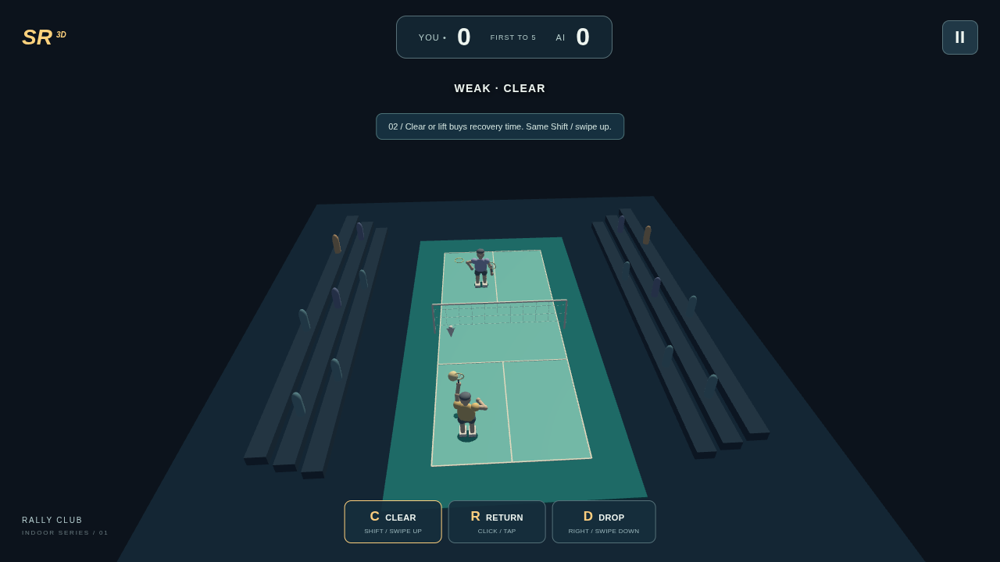
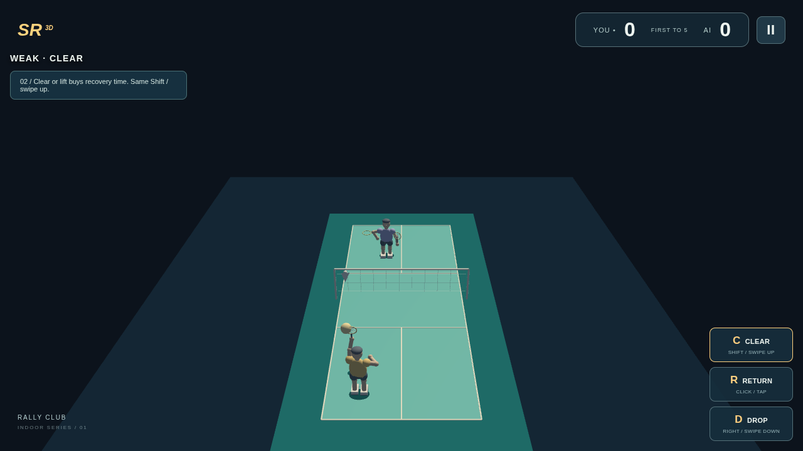
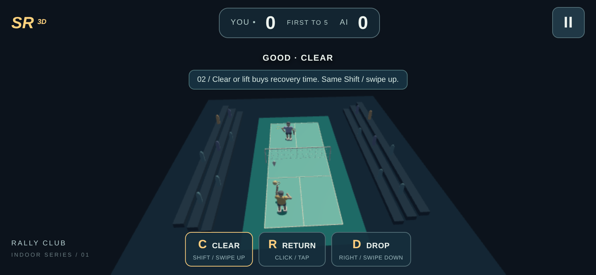
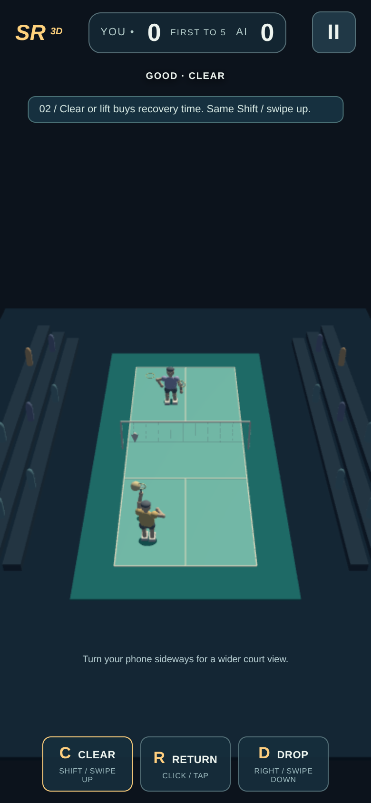
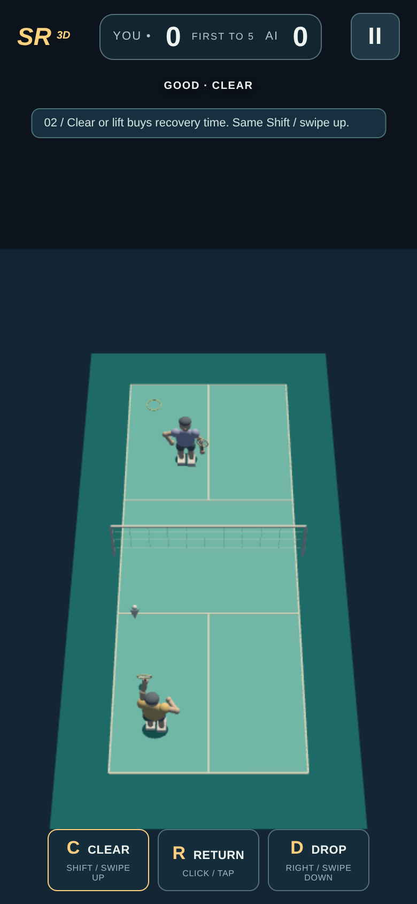
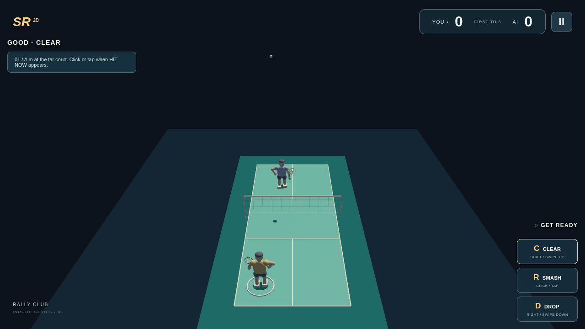
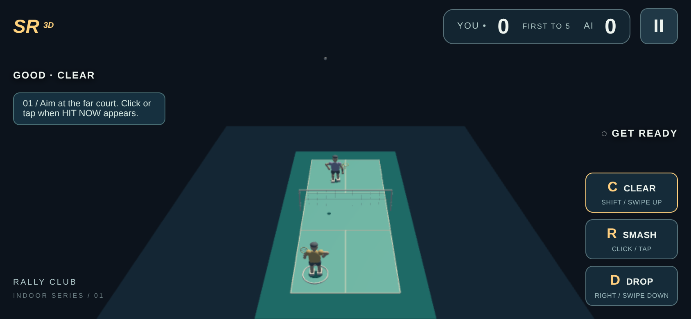
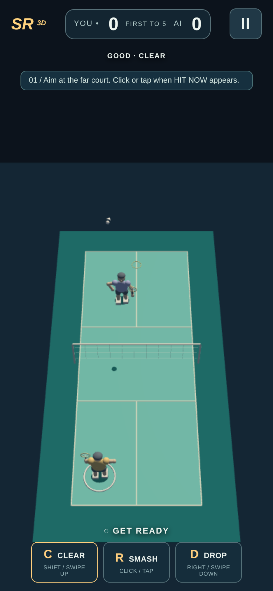
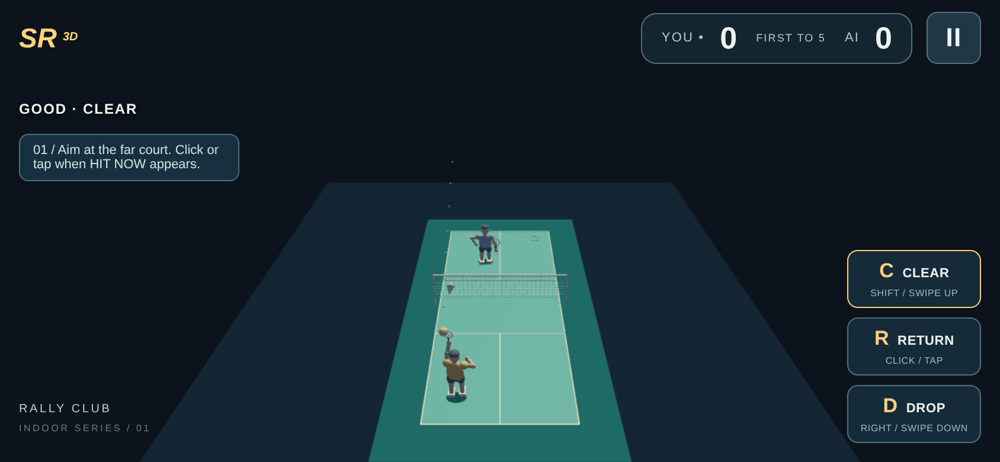
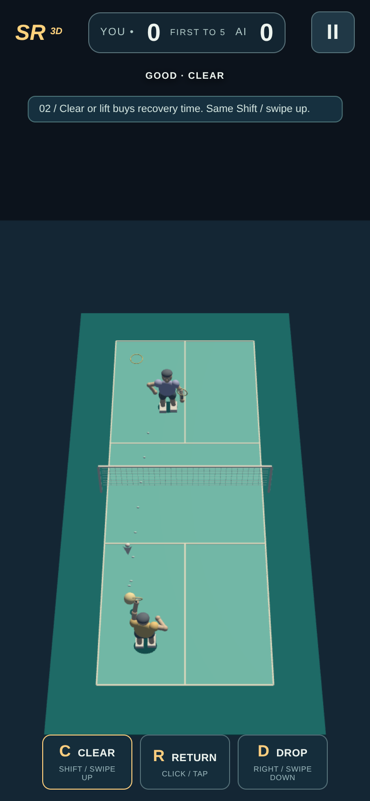

# 관중석 제거·카메라 확대 전후

같은 LOW 품질, 같은 화면 크기/DPR, 같은 EASY 클리어 랠리 입력 절차로 새로 촬영했습니다. 실제 진행 중인 랠리이며 정지·상태 주입을 사용하지 않았습니다. 같은 애니메이션 프레임의 픽셀 비교는 아닙니다. 각 화면에서 3회 리턴 입력으로 실제 6리턴을 확인했습니다. MEDIUM/DPR2 검사 원본은 별도 `final` 폴더에 있습니다.

## PC · 1280×720

관중석 제거 전:

제거·확대 후:

## 모바일 가로 · 844×390 · DPR2

관중석 제거 전:

제거·확대 후:

## 모바일 세로 · 390×844 · DPR2

관중석 제거 전:

제거·확대 후:

## 9m 이상 높은 클리어 · 실제 비행 중 캡처

PC:

모바일 가로:

모바일 세로:

각 캡처 직전의 실제 위치·속도·투영 좌표는 `matched/court-framing-report.json`의 `highClearCapture`에 기록했습니다. 프레임별 관측 최고점은 약9.6–9.8m입니다. 양측 코트 경계와 선수·셔틀콕이 유지되도록 시야를 잡았으며 샷·물리·AI 규칙은 바꾸지 않았습니다.

Library 저장은 준비 전 연결 단계에서 실패해 파일 ID가 없습니다. 이 페이지의 원본 PNG와 `manifest.json`의 해시를 지정 브랜치의 전체 커밋 SHA로 고정해 제공합니다. 물리 기기·Safari·실청음은 미검증입니다.

## 같은 랠리 중 화면 회전 · MEDIUM/DPR2

가로 회전 후 실제 리턴:

다시 세로 회전 후 실제 리턴:

