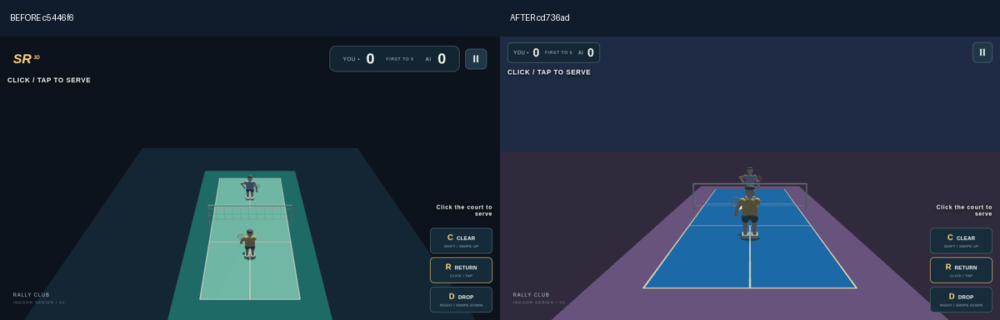

# Low rear composition and articulated racket swings — 2026-10-15

Baseline: c5446f637a23a45d4e80e5a106ce4c1c43cbb51a.
Implementation: cd736ad6cd376c0e926ab7500f66923d23062b7a.

## Scope and source limit

Only projects/SmashRally3D source, tests and evidence are changed. The saved cb-ll project's tracked files are untouched. The remote branch was fetched before work and matched the baseline. No main merge, default promotion or manual deployment.

The exact native Library record for13013.jpg resolves to1065×606 and169400 bytes. The image read returned an asset pointer/caption rather than pixels; official materialization failed three times, including after network escalation and after the environment connection recheck (`library file transfer failed: download failed`). The source was NOT directly visually inspected in this environment. The parent-provided visual measurements grounded the work: low rear third person, broad blue near court, purple runoff, tape45–59% down the view, large near athlete and compact upper-left score. design-qa.md remains blocked for direct source fidelity. No copied third-party assets were used.

## Implementation

- Fixed8° rear view,58° baseline vertical FOV; finite court and athlete bounds determine responsive distance. Landscape tape is52% down the frame; portrait50%.
- Current and briefly anticipated shuttle position widen only the lens. Lens return holds during the human timing/aiming window, preserving inverse projected pointer/touch aim. High-apex athlete size is deliberately smaller than the ordinary ready view.
- Blue original court, purple surround/floor, brighter shuttle and upper-left compact score. Seating and spectators remain absent.
- Serve, basic return, drop, clear and smash have different load, curved shoulder path, wrist flex/pronation and follow-through. Finite two-bone arm constraints and the original contact pose/window remain shared with prediction/physics. Recover continues the same stroke clock and smoothly returns to ready.
- Actual engine racket normal/shaft are exposed through existing read-only diagnostics, allowing rendered basis checks in addition to centre checks. No new gameplay controls, timing clocks or AI/physics parameters.

## Validation and delivery

55/55 tests pass in tests-isolated.txt with no browser running. This includes all previous regression cases and two new meaningful suites for the low-camera contract/high-flight lens and articulated stroke continuity, finite arms, orthogonality, phases and exact reachable impact. Full project/root build and registry sync pass; generated registry changes outside this project were restored. Root build logs are retained.

before-low contains isolated baseline builds from git archive at the exact SHA, never served from a mutable candidate dist. composition contains the same ready state and viewport on the candidate. comparison-*.png assemble these unchanged screenshots side by side. All final original PNG hashes and source bundle identity are in summary.json.

rally uses real visible HIT NOW cues, mouse/native touch and left/centre/right aim. It samples actual engine projections after frameend for court/player/shuttle clipping and captures real high-clear apices. Rotation continues one native touch rally portrait→landscape→portrait without reloading or injecting state. Mobile native up/down tests retain real touch-down reservation and release behaviour.

swings captures real frameend canvas pixels during ordinary mouse/Shift/right-click rallies, with no pause, injected actor/shuttle state, scheduled contactAt commands or pose reconstruction. Each stored hit includes physical and rendered racket agreement. The numbered PNGs are consecutive phase samples of the same actual swing, rather than consecutive video frames; timestamps and joints are in sequences.json. Composed swing-*.png sheets use those exact pixels.

Repeated-DROP browser evidence is bounded software-controller coverage, not human difficulty balance. Unit/domain replays and actual UI observations are kept distinct. Chromium151/ANGLE SwiftShader and native-touch emulation do not certify physical PC/mobile FPS, Safari, human feel or real-device latency.

## Reproduce

Use the repository-declared pnpm9.15.4 through corepack, with cache/store paths writable in this environment. Project build: corepack pnpm --filter smash-rally-3d build. Tests: corepack pnpm --filter smash-rally-3d exec vitest run --maxWorkers=1 --no-file-parallelism. Root: corepack pnpm build:vercel.

Browser tool dependency is isolated in ignored .playtest (puppeteer25), using /usr/bin/chromium; it is not added to project/runtime dependencies. Run tools/verify-reference.sh from the repository. Then run python3 tools/summarize-reference.py from this project's path or use its absolute path. Browser scenarios run serially to avoid SwiftShader contention.

## Attempts and discovered issue

attempts contains incomplete/initial checks and is excluded from the final PNG manifest. Early unit tests under multiple software browsers timed out; the isolated final test run passes without changing test deadlines. The first dynamic-camera PC rally found world aim drift while the lens was returning; the final aiming-window hold fixes it and the final scenario checks projected pixel error. Native touch coordinates are integer-dispatched, so the foreshortened far court is validated by inverse screen error (≤1.5px), while mouse uses≤0.1px. A fixed0.08m depth tolerance is not a valid screen-picking precision guarantee in this low perspective.

Final clear-rally checks pass on PC1280×720, landscape844×390 and portrait390×844: each observes six returns and four player contacts, with zero court/player/shuttle clipping. Maximum inverse aim errors are0.000026px /0.6364px /0.4956px respectively. Full actual high-flight samples and screenshots are in rally.

The initial baseline run used a mutable dist and was discarded as comparison evidence. The isolated baseline MEDIUM portrait wait timed out under contention; the authoritative matched baseline/candidate ready screenshots use LOW quality with the same viewport/DPR settings. These limitations are retained rather than counted as passes.

## Gallery

[PC comparison](comparison-pc.png) · [Landscape comparison](comparison-landscape.png) · [Portrait comparison](comparison-portrait.png)

[Clear wrist/contact detail](swing-clear-detail.png) · [Drop detail](swing-drop-detail.png) · [Serve detail](swing-serve-detail.png)

The detail sheets use a consistent crop of the unmodified originals; crop coordinates and original frame references are stored alongside them. Numbered full-frame PNGs remain available in swings. These are phase samples with explicit timestamps, not a real-time video.

Serve and clear sheets additionally show the next observed ready sample when it occurs within0.25s of the return sample, making completed recovery visible. That last panel reuses the exact subsequent ready PNG and its timestamp; it is not a reconstructed pose. The original sequences.json remains unchanged.

The first mixed UI sequence run observed24 real contacts/23 returns from11 cue-driven return commands. It captured serve, clear and drop preparation→acceleration→contact→impact→follow→return, with zero rendered-centre or basis mismatches. Default inputs at the leading edge of the broad beginner cue legitimately resolve to safe clears; this run is not claimed as natural smash/drive coverage. The five motion profiles, including basic/drive and smash, are separately checked in the finite-arm/continuous-phase unit suite.

## Final additional checks

All nine EASY/NORMAL/HARD ×centre-soft/wide-soft/clear-soft browser windows pass:27 physical AI contacts,18 confirmed successful replies and9 unresolved final replies; zero reply faults and zero direct soft winners. physical-analysis.json independently checks measured motor speed≤5.8m/s and minimum observation delays≥0.5/0.3/0.183s. These are bounded regression windows, not human win rates.

The separate attack replay waits for the visibly tightened timing ring while HIT NOW is visible, then uses a normal mouse click. It records one actual smash and a complete eight-phase sequence through ready return, with zero rendered centre/basis mismatches. It never reads contactAt to schedule input or injects actor/shuttle state. [Smash detail](attack-smash-detail.png), [full-frame sequence](swings-attack/smash), [source record](swings-attack/sequences.json). Browser basic/drive and Super Smash sequences were not captured in this iteration; their domain/finite-arm regressions pass.

Every final browser report has zero runtime errors and the identical candidate source bundle SHA256:8b53e8f2078a2d60808c79febaf46c999db4d7e871fa7c48cbff925e8741141b.

An accidental repeated evidence-run invocation was interrupted and its partial log is retained in attempts; it does not replace or count towards the completed swing-sequence-report.json.

[Download the saved review ZIP](https://chatgpt.com/api/library/files/libfile_b6f549ad87fc8191a6477aaeed03c02b/download). Original archive hash and byte size are in delivery.json.
